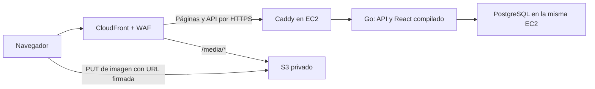

# Arquitectura y reglas del sistema

Este documento describe la implementación del repositorio. El [contrato de rutas](routes_contract.md) detalla endpoints y respuestas; el [README](../README.md) cubre el arranque local y la [guía de despliegue](../deploy/README.md) cubre producción. Si cambias un contrato, actualiza también el cliente TypeScript y estas referencias.

## Recorrido de una petición en producción

Go entrega el ticket firmado de subida; el navegador envía el archivo a S3. En desarrollo,
Vite sirve la interfaz y utiliza un proxy al API Go; las imágenes usan el almacenamiento local.

## Mapa del código

| Área | Archivos que conviene abrir primero |
|---|---|
| Entrada React y navegación | [App.tsx](../frontend/src/App.tsx): portal en `/`, panel cargado por separado en `/admin/*`. |
| Estado del portal | [StudentApp.tsx](../frontend/src/student/StudentApp.tsx), [CourseSelector.tsx](../frontend/src/student/CourseSelector.tsx), [CourseSwitcher.tsx](../frontend/src/student/CourseSwitcher.tsx). |
| Panel y cliente HTTP | [AdminApp.tsx](../frontend/src/admin/AdminApp.tsx), [api.ts](../frontend/src/lib/api.ts), [types.ts](../frontend/src/lib/types.ts). |
| Arranque Go | [main.go](../backend/cmd/server/main.go): configura PostgreSQL, aplica migraciones, crea el primer admin si no existe y abre HTTP. |
| Rutas y dependencias | [app.go](../backend/internal/app/app.go): `App` reúne pool, almacenamiento, correo, cachés y limitador; `Routes()` registra el API. |
| Sesiones y HTTP | [auth.go](../backend/internal/app/auth.go), [http.go](../backend/internal/app/http.go), [ratelimit.go](../backend/internal/app/ratelimit.go). |
| Operaciones del alumno | [student.go](../backend/internal/app/student.go): configuración pública, login, materias, registro, recuperación, tienda y leaderboard. |
| Administración | [admin_students.go](../backend/internal/app/admin_students.go): alumnos y generación; [admin_catalog.go](../backend/internal/app/admin_catalog.go): cursos, insignias, niveles y avatares; [admin_misc.go](../backend/internal/app/admin_misc.go): compras, ajustes, admins y subidas. El panel rápido heredado usa [admin_core.go](../backend/internal/app/admin_core.go). |
| Datos externos y actividad | [sheets.go](../backend/internal/app/sheets.go), [importer.go](../backend/internal/app/importer.go), [audit.go](../backend/internal/app/audit.go), [undo.go](../backend/internal/app/undo.go). |

El backend usa `net/http` y SQL mediante `pgx`; los manejadores y las reglas viven en el paquete `internal/app`, sin ORM ni capa separada de repositorios. El [Dockerfile](../Dockerfile) empaqueta el build Vite y el binario Go; [web.go](../backend/internal/app/web.go) sirve la SPA y conserva las rutas del navegador. `legacy/` conserva la aplicación anterior como referencia; no es el código que sirve la app migrada.

## Modelo: matrícula e inscripción

El esquema está en [0001_init.sql](../backend/internal/app/migrations/0001_init.sql). La distinción principal es:

- `students.code` es la **matrícula** y representa la identidad compartida entre materias. No existe una tabla global de usuarios alumnos.
- La matrícula se trata como texto: conserva ceros iniciales y no conviertas IDs a números ni cambies sus mayúsculas/minúsculas para comparar identidades.
- `students.id` es una **inscripción**: una matrícula dentro de un `course_id`. La combinación `(course_id, code)` es única. Nombre, correo, contraseña, contadores, EXP y comentarios se guardan por inscripción.
- `Student.id` en la respuesta del portal es la matrícula de texto; `AdminStudent.id` es el ID numérico de inscripción; `courses[].id` es el ID numérico del curso. Evita intercambiarlos.
- `purchases.student_id` apunta a la inscripción: monedas, compras y leaderboard corresponden a la materia abierta. `avatars` usa `(code, level)`, por lo que el avatar sí se comparte entre materias.

`courses` contiene nombres, pestañas/alias de Sheets, imágenes, orden y estado. `badges` es el catálogo global; `course_hidden_badges` excluye insignias por curso. `levels` define umbrales de EXP. `settings` guarda ajustes sobrescritos, `admins` cuentas independientes y `reset_codes` códigos por inscripción. `audit_log` guarda instantáneas y lotes.

No cambies una matrícula reutilizándola para otra persona: la identidad multicurso y los avatares dependen de esa igualdad. Las altas nuevas validan matrícula y nombre; la importación admite datos heredados con limpieza de controles, y editar otros campos permite conservar valores heredados sin cambiarlos.

## Login, materia seleccionada y contraseñas

`POST /api/login` recibe `{studentId, password}`; `career` sigue siendo opcional para clientes anteriores. Una contraseña válida en **cualquier inscripción activa de un curso activo** autentica la matrícula y permite listar todas sus inscripciones vigentes. Una inscripción desactivada no sirve para autenticar otras.

La respuesta contiene `student`, `courses`, `levelUpOccurred` y `requiresCourseSelection`. Con una materia entra directo; con varias muestra tarjetas de materia y logo. La cookie conserva la selección pendiente: recargar mediante `GET /api/me` sigue mostrando tarjetas hasta `POST /api/switch-course` con `{courseId}`. Mientras tanto no se registra la visita ni se consume la animación de nivel del primer curso. Tras elegir, `/api/me` conserva la materia seleccionada.

La cookie `diseno_alumno` es un payload firmado con HMAC-SHA256, con `HttpOnly`, `SameSite=Lax` y `Secure` según configuración. Dura 12 horas y contiene:

| Claim | Significado |
|---|---|
| `i` | ID de la inscripción actualmente abierta. |
| `a` | ID de la inscripción cuya contraseña autenticó la sesión. |
| `c` | Matrícula compartida. |
| `v` | Versión derivada del hash de la contraseña autenticadora (`pwVersion`). |
| `e`, `p`, `k` | Vencimiento absoluto, selección pendiente y tipo de sesión. |

`requireStudent` comprueba en PostgreSQL que origen y destino existen, siguen activos, pertenecen a cursos activos y mantienen la misma matrícula; también revalida `v`. Cambiar materia conserva `a`, `v` y el vencimiento original. Cambiar/restablecer la contraseña autenticadora, desactivar/eliminar su inscripción o cambiar su matrícula revoca toda esa sesión aunque esté abierta otra materia. Cambiar la contraseña de una inscripción distinta no revoca esa sesión. Las cookies antiguas sin `a` usan `i` como origen. Los administradores usan otra cookie, `diseno_admin`, con validación de su propia contraseña y estado.

**Las contraseñas heredadas por materia pueden ser distintas y no se sincronizan automáticamente.** Registro y recuperación siguen pidiendo materia. Registrarse en otra materia con una matrícula existente exige conocer la contraseña de alguna inscripción de esa matrícula; se guarda un hash independiente para la nueva inscripción. El panel también puede crear inscripciones o restablecer su clave individualmente.

La recuperación usa códigos aleatorios de seis dígitos guardados como SHA-256, con vigencia configurable, cinco intentos fallidos y límites de envío. Reenviar un código vigente conserva los intentos; un código agotado bloquea nuevos envíos hasta vencer. Al restablecer se cambia solo la contraseña de la materia elegida y se elimina el código. El [correo](../backend/internal/app/mail.go) usa Resend: la respuesta de envío del código puede ser correcta aunque falle el proveedor; el fallo queda en el log.

## Tienda, auditoría y deshacer

La compra en [student.go](../backend/internal/app/student.go) usa una transacción para todo el carrito. Toma la inscripción de la sesión, bloquea primero al alumno y después las insignias ordenadas por ID; valida visibilidad, estado, stock, precio actual y monedas. `unitCost` del cliente solo detecta un precio cambiado, no fija el cobro. Una falla revierte todo. El correo de confirmación se envía después del commit y no revierte la compra si falla.

Cada insignia comprada crea una fila de `purchases`, con cantidades, costo y monedas antes/después; el carrito comparte `batch_id`. El panel puede revertir/restaurar compras devolviendo/cobrando monedas y stock con validaciones transaccionales.

Los cambios auditables escriben `before`/`after` en la misma transacción que los datos. [undo.go](../backend/internal/app/undo.go) bloquea la entrada, detecta conflictos con cambios posteriores y ofrece forzar solo cuando aplica; no equivale a restaurar arbitrariamente toda la fila. Deshacer y rehacer dejan nuevas entradas enlazadas mediante `reverts_id`. Los lotes se deshacen del más reciente al más antiguo y se rehacen al revés; un lote general puede devolver éxitos y fallos parciales, mientras el resumen de una importación aplica su lote en una transacción. No todas las entradas son reversibles: por ejemplo, el bootstrap del admin y la recuperación por código no lo son. Las instantáneas almacenadas pueden incluir hashes bcrypt para restaurarlos; las respuestas de actividad los eliminan junto con los secretos. Eso no significa que la bitácora completa esté cifrada como los ajustes secretos.

## Importación compatible con Google Sheets

[sheets.go](../backend/internal/app/sheets.go) usa una cuenta de servicio con alcance de **solo lectura**: obtiene metadatos y hace `values:batchGet` con valores formateados. Nunca escribe en la hoja. El ID/URL y las credenciales pueden venir en la petición o en Ajustes; las credenciales enviadas solo para una importación no se guardan. La URL de tokens se fija al endpoint de Google, sin confiar en `token_uri` del JSON.

La pestaña de cada curso se resuelve con `sheet_name` y `sheet_aliases`, incluso para cursos que no están activos en el portal. La fila 1 se interpreta como encabezado. El rango de alumnos es **A:N**:

| Columna | Contenido / destino |
|---|---|
| A | Matrícula → `code`. |
| B | Nombre → `name`. |
| C | Sexo → `sexo`; vacío queda `N/A`. |
| D | Correo → `email`; vacío usa matrícula y dominio configurado. |
| E | Contraseña en texto → `password_hash` bcrypt. |
| F | Tareas → `tareas`. |
| G | Monedas → `monedas`. |
| H | Asistencias → `asistencias`. |
| I | Conteo antiguo de insignias: se ignora; se deriva de compras. |
| J | Experiencia → `exp`. |
| K | Último nivel visto → `last_login_level`. |
| L | Juegos → `games`. |
| M | Se ignora. |
| N | Comentarios → `comments`. |

`Badges!A:C` contiene **nombre, existencias, costo**. `Purchases!A:E` contiene **fecha, matrícula, nombre de insignia, cantidad, carrera**; E puede faltar en filas antiguas. Sin materia identificable, una compra solo se asigna si la matrícula tiene una única inscripción; si hay ambigüedad se omite con aviso. Las fechas se interpretan en `America/Mexico_City` con formatos heredados. Los números conservan el comportamiento permisivo de `parseInt` anterior y generan avisos cuando corresponde.

`POST /api/admin/import/preview` simula sin escrituras dentro de una transacción de solo lectura. `/run` responde `202 {jobId}` y el panel consulta `/jobs/{jobId}` hasta `done` o `error`. Hay una importación real/media a la vez por proceso; la corrida tiene límite de diez minutos y aplica datos/auditoría en una sola transacción. Los trabajos viven en memoria: reiniciar el servidor pierde su estado de consulta, aunque los datos que llegaron a commit y su auditoría permanecen. Al iniciar nuevas corridas se depuran trabajos terminados hace más de un día.

Hay dos modos: `upsert` crea/actualiza y `create_only` omite registros ya existentes. Alumnos se identifican por curso/matrícula e insignias por slug. Si la contraseña importada coincide se conserva el hash; si está vacía se mantiene la del alumno existente o se genera una para el nuevo, con aviso para restablecerla y entregarla. Compras usan `source_ref` único: una huella de sus datos y ocurrencia entre filas idénticas evita duplicarlas al reimportar o reordenar filas. **Importarlas no vuelve a descontar monedas ni existencias**; sí agrega historial reversible. Editar los datos de una compra en Sheets cambia su huella y puede crear otra fila histórica: no es una sincronización bidireccional.

## Imágenes, niveles y configuración

[storage.go](../backend/internal/app/storage.go) implementa almacenamiento local y S3. El panel pide un ticket a `POST /api/admin/uploads` y hace un `PUT` directo al destino firmado; después guarda la URL `/media/...` en el registro correspondiente. Admite PNG, JPG, GIF y WEBP de hasta 20 MB; el ticket vence a los 15 minutos. En local lee `MEDIA_DIR` y, como respaldo, `MEDIA_SEED_DIR`; en producción el comportamiento `/media/*` está preparado para S3 mediante CloudFront. Las imágenes nuevas `/media/u/...` deben existir antes de asociarlas.

Los avatares se buscan por matrícula y nivel exacto, después por `DefaultH` si sexo es `Hombre` o `DefaultF` para los demás valores. [0003_default_avatars.sql](../backend/internal/app/migrations/0003_default_avatars.sql) siembra doce casillas: H0–H5 apuntan a sus archivos respectivos; F0–F5 usan el único archivo femenino heredado, `DefaultF0.png`. `ON CONFLICT DO NOTHING` conserva imágenes personalizadas. Importar media registra casillas todavía libres e imágenes heredadas de insignias sin sobrescribir las existentes. La migración referencia archivos de [seed/media](../seed/media); estos deben estar disponibles en disco/S3 según entorno.

El nivel se calcula con [levels.go](../backend/internal/app/levels.go) a partir de EXP, no se guarda como nivel actual. `last_login_level` registra el último visto para la animación. Ajustes y niveles tienen caché de un minuto y se invalidan al confirmar cambios del panel/deshacer.

[config.go](../backend/internal/app/config.go) lee variables de proceso: conexión PostgreSQL, secreto de sesión, URL pública/cookies/proxy, rutas web/media, almacenamiento y parámetros del SDK WAF. [settings.go](../backend/internal/app/settings.go) combina valores predeterminados con sobrescrituras de PostgreSQL; para secretos usa primero el valor guardado y después el respaldo del entorno. Las claves de Resend y la cuenta de servicio de Google se cifran con AES-256-GCM usando una clave derivada de `SESSION_SECRET`, y el API expone solo su estado de configuración. Cambiar ese secreto invalida sesiones y deja ilegibles los ajustes cifrados anteriores; hay que volver a configurarlos. No copies credenciales a documentación ni a fixtures persistentes.

El middleware exige JSON en mutaciones del API, comprueba `Origin` cuando existe y agrega CSP/cabeceras de seguridad. El cuerpo del API se limita a 64 KB, pero [api.ts](../frontend/src/lib/api.ts) usa 8 KB por compatibilidad con el WAF y divide operaciones masivas. El SDK del WAF se inyecta desde Go cuando está configurado; el cliente usa su `fetch` para adjuntar el token del WAF al API propio, no a las subidas de S3. Los límites de login y los turnos bcrypt son locales al proceso; IPv6 se agrupa por `/64`.

## Al extender el backend

Agrega cambios de esquema como un nuevo SQL ordenado en [migrations](../backend/internal/app/migrations); [migrate.go](../backend/internal/app/migrate.go) los incorpora al binario, aplica cada archivo pendiente en una transacción y registra `schema_migrations`, bajo un candado de PostgreSQL. Mantén las migraciones ya aplicadas sin reescribirlas.

Preserva las transacciones con auditoría, el orden de bloqueo de compras y la distinción matrícula/inscripción. Cambios de tipos o rutas deben acompañarse en [types.ts](../frontend/src/lib/types.ts), [api.ts](../frontend/src/lib/api.ts) y el [contrato](routes_contract.md). Para tocar autenticación multicurso consulta [student_courses_test.go](../backend/internal/app/student_courses_test.go); para importación, [importer_test.go](../backend/internal/app/importer_test.go); para recuperación/concurrencia, [security_test.go](../backend/internal/app/security_test.go). Las pruebas de integración necesitan `DATABASE_URL` y crean esquemas aislados; sin esa variable se omiten, por lo que un `go test` sin PostgreSQL no valida esos flujos.
